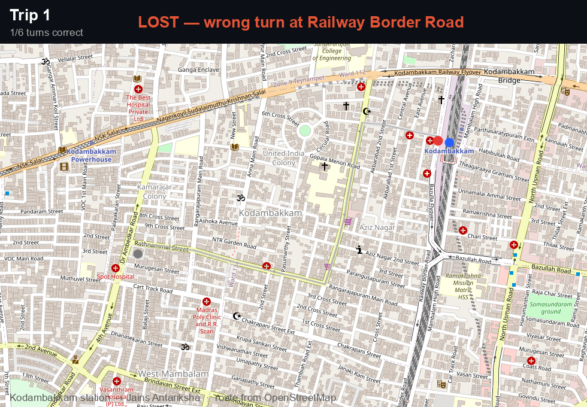
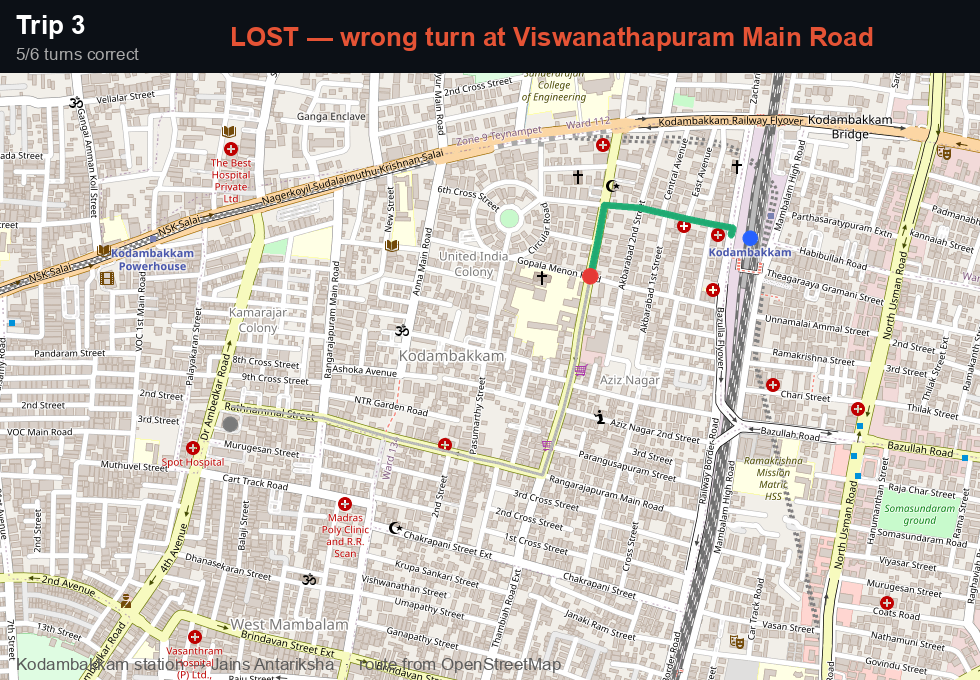
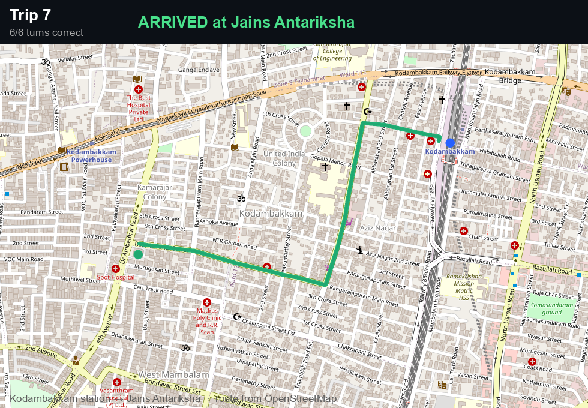

<h1 align="center">🚗 RouteMind</h1>

<p align="center"><b>A car that teaches itself a route on real roads — by learning from its own wrong turns.</b></p>

<p align="center">
  Drive from <b>Kodambakkam railway station</b> to <b>Jains Antariksha</b> (Chennai). The streets and
  turns are real (OpenStreetMap). The car starts with a head full of <i>wrong</i> directions and,
  trip by trip, learns which turns actually get it there — recursive self-improvement you can watch
  on the map.
</p>

---

## Watch it learn

| Trip 1 — lost immediately | Trip 3 — gets most of the way | Trip 6 — arrives |
|---|---|---|
|  |  |  |

```
 trip | turns right | result            || RAG (frozen memory)
   1  |    1/6      | lost @ 1st turn    ||  1/6  lost @ 1st turn
   3  |    4/6      | lost near the end  ||  1/6  lost @ 1st turn
   6  |    6/6      | ARRIVES ✅          ||  1/6  still lost
```

The car (Mnemo) **arrives by trip 6**. A frozen-memory baseline (RAG) **never gets past the first turn.**

## How it works

- **Real route:** we geocode the two points and pull the actual driving route + turn-by-turn from
  OpenStreetMap (Nominatim + OSRM) — real Kodambakkam streets.
- **The task:** at each junction the car **recalls which way to turn** from memory. Its memory holds
  the correct turn **plus noise** — wrong turns from bad past trips.
- **It compounds:** one wrong recall sends it off-route, so a trip only completes when **every**
  junction is recalled correctly.
- **The self-improvement:** each trip is graded (and the car is corrected, so every junction gets
  learned). The memory engine scores each remembered turn by whether recalling it helped, **keeps the
  good ones, forgets the wrong ones** — so the route locks in over a handful of trips, with no retraining.

That feedback loop — recall → drive → learn what helped → forget the noise → **better recall next trip** —
is the recursive self-improvement.

## Run it

```bash
python3 -m venv .venv && source .venv/bin/activate
pip install openai pymongo python-dotenv numpy staticmap matplotlib pillow
# .env: OPENAI_API_KEY (embeddings), optional MONGODB_URI

python run_nav.py              # learn the route (local vector store)
python run_nav.py --atlas      # same, backed by MongoDB Atlas Vector Search
python render_nav.py           # render the map screenshots into out/
```

## Credits

- **OpenStreetMap** — the road network · **Nominatim** (geocoding) · **OSRM** (routing) · **staticmap** (tiles).
- Memory engine (`memory.py`) is the **Mnemo** self-improving memory: usefulness-weighted recall + forgetting
  on a vector store (local or **MongoDB Atlas**).
- Everything else here (`nav_tasks.py`, `run_nav.py`, `render_nav.py`) written for this demo.

---

<p align="center"><i>It got lost, then it learned the way.</i></p>
