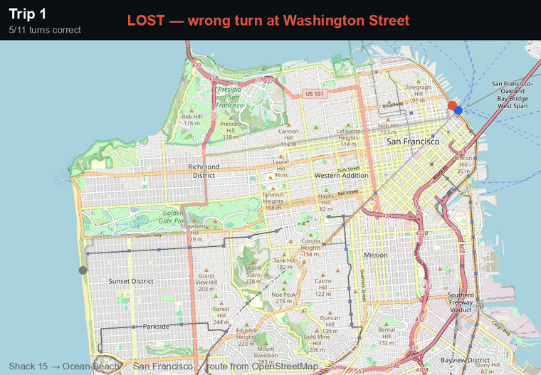
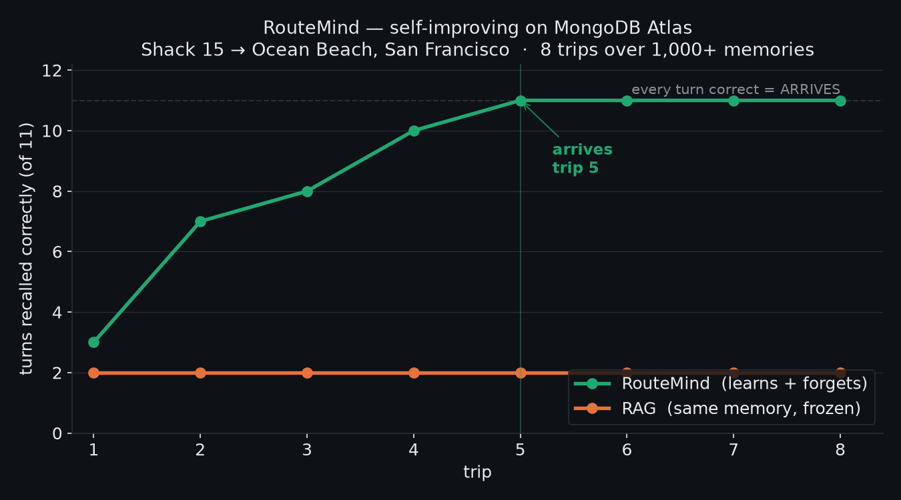
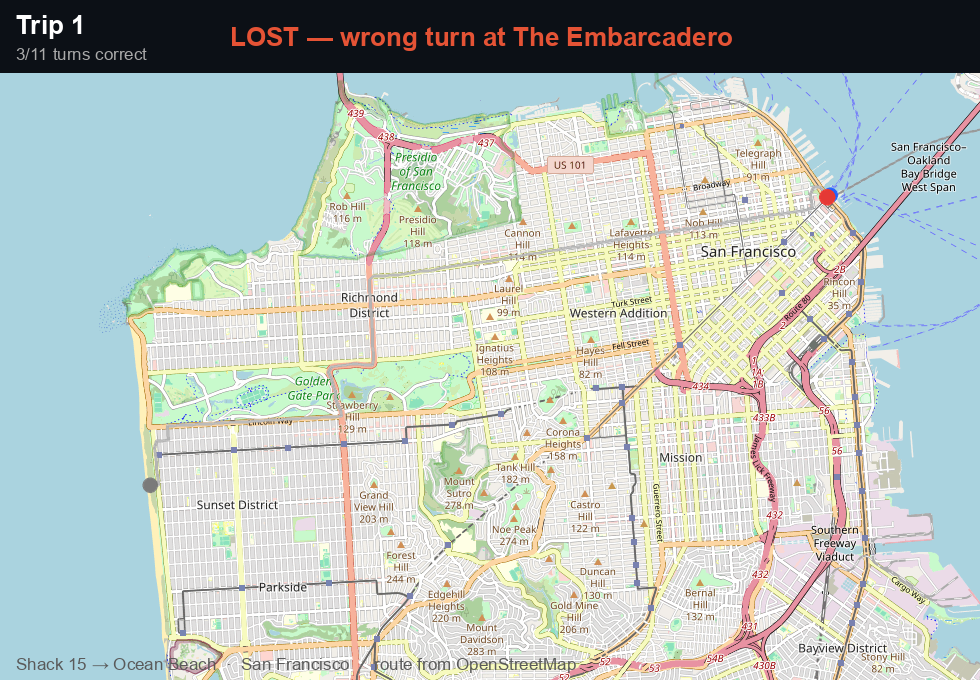
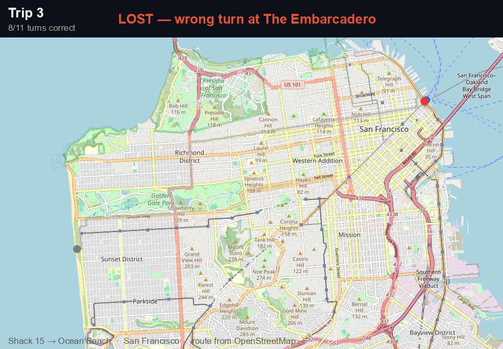
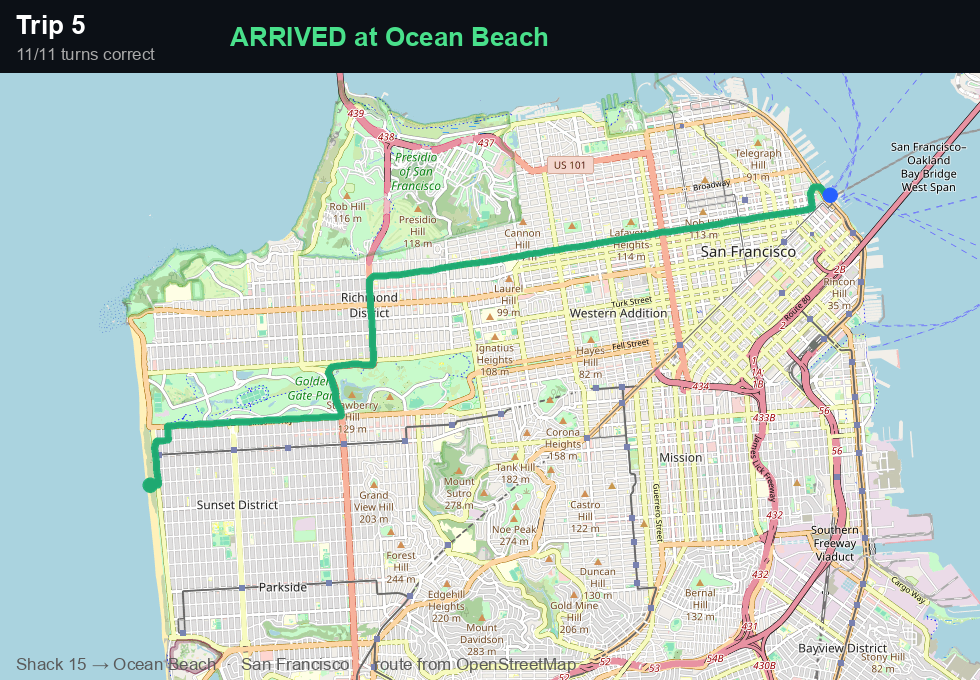

<h1 align="center">🚗 RouteMind</h1>

<p align="center"><b>A car that teaches itself a real San Francisco drive — by learning from its own wrong turns.</b></p>

<p align="center">
  Start at <b>Shack 15</b> (the Ferry Building) and drive to <b>Ocean Beach</b>. The streets and turns
  are real (OpenStreetMap). The car begins with a head full of <i>wrong</i> directions buried in a
  store of <b>1,000+ memories</b> and, trip by trip, learns which turns actually get it there —
  recursive self-improvement you can watch on the map, on <b>MongoDB Atlas Vector Search</b>.
</p>

---

## ▶ Live demo

**Interactive app:** https://tets-mv4eiaze9dc-prod.cloud.modelence.app

Type any start and destination, press **Drive**, and watch the memory learn the route trip by trip.
A **Pitch** tab tells the story. Deployed on Modelence, reading MongoDB Atlas live.

**Built on:** [MongoDB Atlas](https://www.mongodb.com/atlas) (Vector Search) ·
[Voyage AI](https://www.voyageai.com) (embeddings) · [Raindrop](https://www.raindrop.ai) (observability) ·
[Modelence](https://modelence.com) (hosting) · [ElevenLabs](https://elevenlabs.io) (narration) ·
OpenStreetMap (routes). The deployed app source is in [`dashboard/`](dashboard).

For judges: [SUBMISSION.md](SUBMISSION.md) (MongoDB write-up), [SPONSORS.md](SPONSORS.md) (integrations),
[ATLAS_DEMO.md](ATLAS_DEMO.md) (show it live in the Atlas console).

---

## Watch it learn

<p align="center">
  <br>
  <i>Every trip the green path pushes further across San Francisco — until it arrives. (<a href="docs/learning.mp4">mp4</a>)</i>
</p>

<p align="center"></p>

| Trip 1 — lost early | Trip 3 — most of the way | Trip 4 — arrives |
|---|---|---|
|  |  |  |

Run on **MongoDB Atlas Vector Search over 1,081 turn-memories** (33 correct, 1,048 noise, of which
960 are decoy turns from 160 other San Francisco junctions the search has to sift through), with
embeddings from **Voyage AI** (voyage-3.5, 1024-d):

```
 trip | turns right | result            || RAG (frozen memory)
   1  |   3/11      | lost early         ||  2/11  lost at the first turn
   3  |   8/11      | most of the way    ||  2/11  lost at the first turn
   5  |  11/11      | ARRIVES            ||  2/11  still lost
```

The car (RouteMind) **arrives by trip 5**. A frozen-memory baseline (RAG), the same 1,081 memories
with no learning, **never gets past the first turn.** That is the whole point: same vectors, the only
difference is that RouteMind *learns which memories help and forgets the ones that mislead*.

## Try it on localhost 🖥️

An interactive dashboard. **Type any start and destination** — RouteMind builds the real
OpenStreetMap route live, then press **Drive** and watch the car learn it trip by trip on the map
while the self-improvement curve fills in. Flip **learning off** to watch plain RAG stay lost. The
engine runs for real on every click.

```bash
python3 -m venv .venv && source .venv/bin/activate
pip install -r requirements.txt
# .env needs OPENAI_API_KEY (embeddings); MONGODB_URI only for --atlas

python app.py          # → open http://localhost:5050
```

Try *Golden Gate Bridge → Oracle Park*, *Shack 15 → Ocean Beach*, or anywhere you like — each becomes
a fresh memory store (1,000+ vectors) the car has to learn its way through.

## How it works

- **Real route:** we geocode the two points and pull the actual driving route + turn-by-turn from
  OpenStreetMap (Nominatim + OSRM). Change the route with one command (see below).
- **The task:** at each junction the car **recalls which way to turn** from memory. Its memory holds
  the correct turn **plus noise** — wrong turns from bad trips, and decoy turns from junctions all
  over the city.
- **It compounds:** one wrong recall sends it off-route, so a trip only completes when **every**
  junction is recalled correctly.
- **The self-improvement:** each trip is graded (and the car corrected, so every junction gets
  learned). The memory engine scores each remembered turn by whether recalling it helped, **keeps the
  good ones, forgets the wrong ones** — so the route locks in over a handful of trips, no retraining.

That loop — recall → drive → learn what helped → forget the noise → **better recall next trip** — is
the recursive self-improvement.

**Scale & MongoDB:** the store holds **1,081 vectors**. Recall is a **filtered `$vectorSearch`**
(`memory.py` → `AtlasStore.search`) scoped to the current junction, so Atlas finds this junction's
three candidate turns inside a whole city of memories; usefulness-weighting then picks the one that
arrives. Learning writes back to Atlas — `update_stats` persists usefulness, `prune` **deletes** the
turns that keep misleading.

> **Demoing this?** See [DEMO.md](DEMO.md) — the one-liner, the live Atlas run, the localhost app, and how to record the clip.

## Run it

```bash
python run_nav.py              # learn the route (local vector store)
python run_nav.py --atlas      # same, backed by MongoDB Atlas Vector Search (1,081 memories)
python render_nav.py           # per-trip maps + out/<route>/learning.mp4 and .gif
python graph.py                # the learning-curve chart
python app.py                  # interactive localhost dashboard (:5050)
```

### Any two points, any city

Routes live under `nav/<slug>/`. Build a new one straight from OpenStreetMap:

```bash
python build_route.py --slug sf \
  --start "Ferry Building, San Francisco" --goal "Ocean Beach, San Francisco" \
  --start-label "Shack 15" --goal-label "Ocean Beach" --city "San Francisco"

ROUTEMIND_ROUTE=sf python run_nav.py --atlas    # pick the route with the env var
```

Ships with two: **`sf`** (Shack 15 → Ocean Beach, default) and **`chennai`** (Kodambakkam station →
Jains Antariksha) — proof it's the *memory* learning, not a route baked into the code.

## Sponsors and partners

- **MongoDB Atlas Vector Search** is the recall engine and the durable, self-evolving memory.
- **Voyage AI** (voyage-3.5, 1024-d, via MongoDB's hosted endpoint) generates the embeddings.
- **Raindrop** streams every recall as an AI interaction, so the self-improvement is observable (`raindrop.py`).
- **Modelence** hosts the deployed dashboard (`dashboard/`), which reads the same Atlas cluster live.
- **ElevenLabs** narrates the dashboard.
- **OpenStreetMap** (Nominatim geocoding, OSRM routing), with **staticmap**, **Leaflet**, and **Chart.js** for the maps and charts.

Everything in this repo (`memory.py`, `nav_tasks.py`, `run_nav.py`, `render_nav.py`, `build_route.py`,
`graph.py`, `app.py`, `seed_atlas_demo.py`, `atlas_pipeline.py`, `recreate_index.py`, and the Modelence
`dashboard/`) was written for this project.

---

<p align="center"><i>It got lost in San Francisco, then it learned the way.</i></p>
